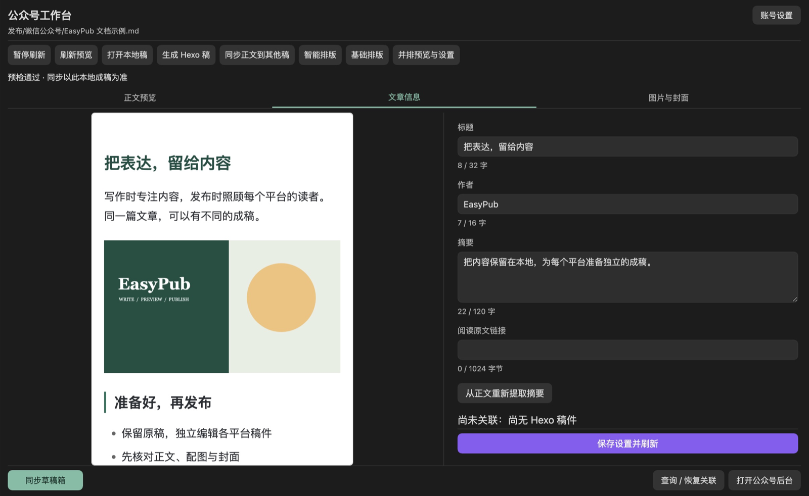
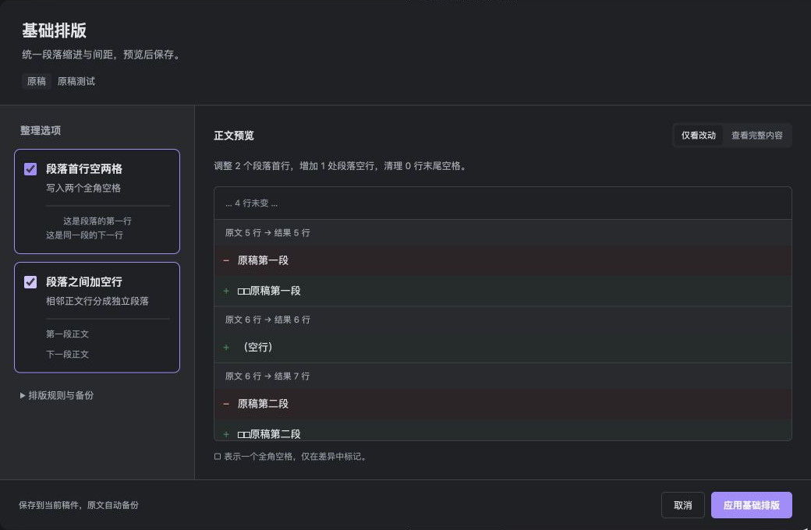
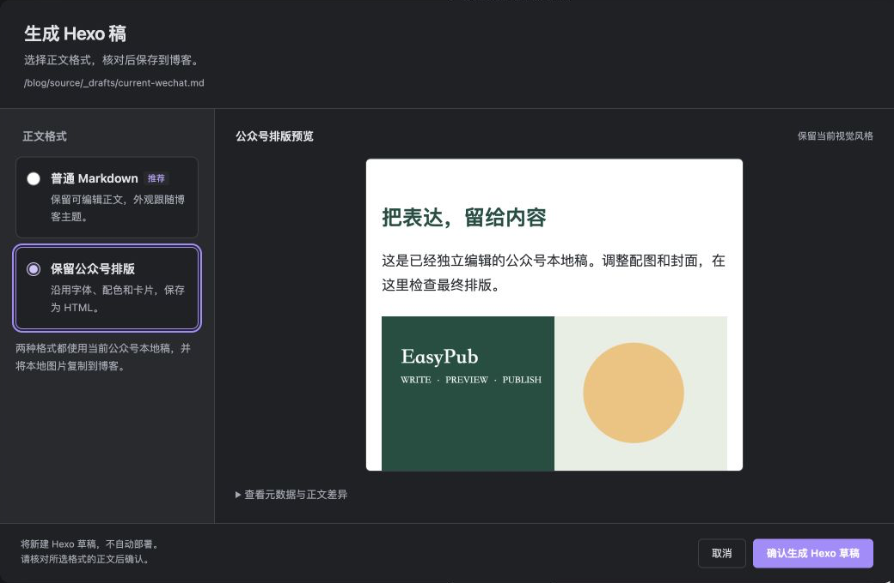

<div align="center">

# EasyPub

**在 Obsidian 写作，为不同平台准备成稿。**

[产品说明网站](https://threeyang3.github.io/easyPub/) · [下载 1.9.4](https://github.com/threeyang3/easyPub/releases/tag/1.9.4) · [快速开始](docs/getting-started.md) · [文档中心](docs/README.md) · [更新记录](docs/releases/1.9.4.md)

适用于桌面版 Obsidian 1.5.7 及以上版本。

</div>



<p align="center"><sub>先在本地完成成稿，再决定何时同步或发布。界面配图使用演示稿件；显示效果会随 Obsidian 主题变化。</sub></p>

<a id="能力与边界"></a>

## 一篇原稿，各自成稿

EasyPub 把源笔记整理为 Hexo、微信公众号、知乎和小红书的独立发布稿。原稿继续用于写作，各平台稿可以分别调整标题、正文和配图；需要复用修改时，再选择要同步的内容并核对差异。

| 平台 | 稿件保存在 | 可以继续做什么 |
| --- | --- | --- |
| 微信公众号 | Vault 内，默认 `发布/微信公众号/` | 预览正文、选择风格、调整封面、同步微信草稿箱 |
| Hexo | 博客仓库的 `source/_posts/` 或已有草稿位置 | 在 Obsidian 编辑，构建、预览或进入管理后台部署 |
| 知乎 | Vault 内，默认 `发布/知乎/文章/` 或 `想法/` | 编辑独立稿件，再自行发布到平台 |
| 小红书 | Vault 内，默认 `发布/小红书/` | 编辑独立稿件，再自行发布到平台 |

> **本地成稿、远端草稿、正式发布是三个阶段。**
> 公众号同步保存到草稿箱，正式发布仍在微信后台完成；知乎、小红书由你自行发布。Hexo 自动部署默认关闭，兼容 Blog Control Room 的博客进入其受保护发布流程。

<a id="安装"></a>
<a id="快速开始"></a>

## 从第一篇稿件开始

1. **安装插件。** 从 [Releases](https://github.com/threeyang3/easyPub/releases/latest) 下载同版 `main.js`、`manifest.json`、`styles.css`，放入 Vault 的 `.obsidian/plugins/easy-pub/` 并启用。
2. **打开原稿。** 点击左侧工具栏“打开 EasyPub 发布面板”，再选择“创建 / 更新发布稿”和目标平台。
3. **确认后编辑。** 核对属性预览，生成独立稿件；公众号进入工作台，其他平台打开对应 Markdown 文件。

第一次只生成本地稿时，公众号不需要连接账号，知乎和小红书也无需额外服务。使用 Hexo 时先配置博客仓库路径。

[跟着快速开始完成第一篇稿件](docs/getting-started.md)

## 公众号成稿，在一个工作台里检查

正文预览、文章信息、图片与封面各有自己的位置。十二套本地风格可以直接试用；需要 AI 建议重点与组件时，再配置服务并逐次确认发送内容。

- 公众号本地稿独立保存，已有稿件默认直接打开。
- 双比例封面分别调整横版 **2.35:1** 与方形 **1:1** 构图。
- 同步前检查正文、图片、封面与账号状态；后台内容变化时先核对冲突。

[公众号工作台](docs/wechat.md) · [主题与智能排版](docs/wechat-layout.md)

## 整理 Markdown，也能先看改动

“基础排版”适用于原稿和全部平台稿。首行写入两个全角空格、段落之间加空行可以分别选择；核对差异后保存，写入前保留原文备份。重复应用不叠加空格或空行，标题、代码、列表、引用和表格保留结构。



[了解基础排版与跨稿正文同步](docs/publishing-workbench.md)

## 生成 Hexo 稿，选择合适的正文格式

| 输出方式 | 适合的目标 |
| --- | --- |
| **普通 Markdown（默认）** | 保持源码易编辑，让字体、颜色和间距跟随博客主题 |
| **保留公众号排版** | 将当前视觉效果保存为带样式的 HTML，并引用配套 CSS |

两种方式都使用当前公众号本地稿，先预览再保存，不自动部署博客。普通 Markdown 模式复制本地原图，保留远程图片网址。



[查看生成方式及后续编辑规则](docs/wechat-association.md#从公众号稿生成-hexo-稿)

<a id="阅读路径"></a>

## 按你的工作流继续

| 现在想做什么 | 阅读入口 |
| --- | --- |
| 安装、升级，完成第一篇本地稿 | [快速开始](docs/getting-started.md) |
| 管理原稿、平台稿和正文同步 | [发布面板与基础排版](docs/publishing-workbench.md) |
| 准备公众号正文、配图和封面 | [公众号工作台](docs/wechat.md) |
| 使用 Hexo 图片、构建和预览 | [发布机制](docs/publishing.md) · [Control Room](docs/control-room.md) |
| 处理失败、恢复备份或迁移电脑 | [故障排查](docs/operations/troubleshooting.md) · [备份与恢复](docs/operations/backup-and-recovery.md) |
| 查命令、配置与属性归属 | [参考手册](docs/README.md#参考手册) |

升级时保留自己的 `data.json`，一起替换同版三个安装文件。版本、宿主与真实服务的验证范围见[版本状态](docs/status.md)。

<a id="开发"></a>

<details>
<summary>开发与贡献</summary>

```bash
git clone https://github.com/threeyang3/easyPub.git
cd easyPub
npm ci
npm test
npm run build
```

构建包含类型检查，并同步生产产物到 `release/`；不会自动安装到 Vault。

[开发环境](docs/development/setup.md) · [架构](docs/development/architecture.md) · [测试](docs/development/testing.md) · [贡献约定](docs/development/contributing.md) · [发布流程](docs/development/releasing.md)

仓库约束见 [AGENTS.md](AGENTS.md) 与 [CLAUDE.md](CLAUDE.md)。

</details>

<a id="许可证"></a>

[MIT License](LICENSE)
