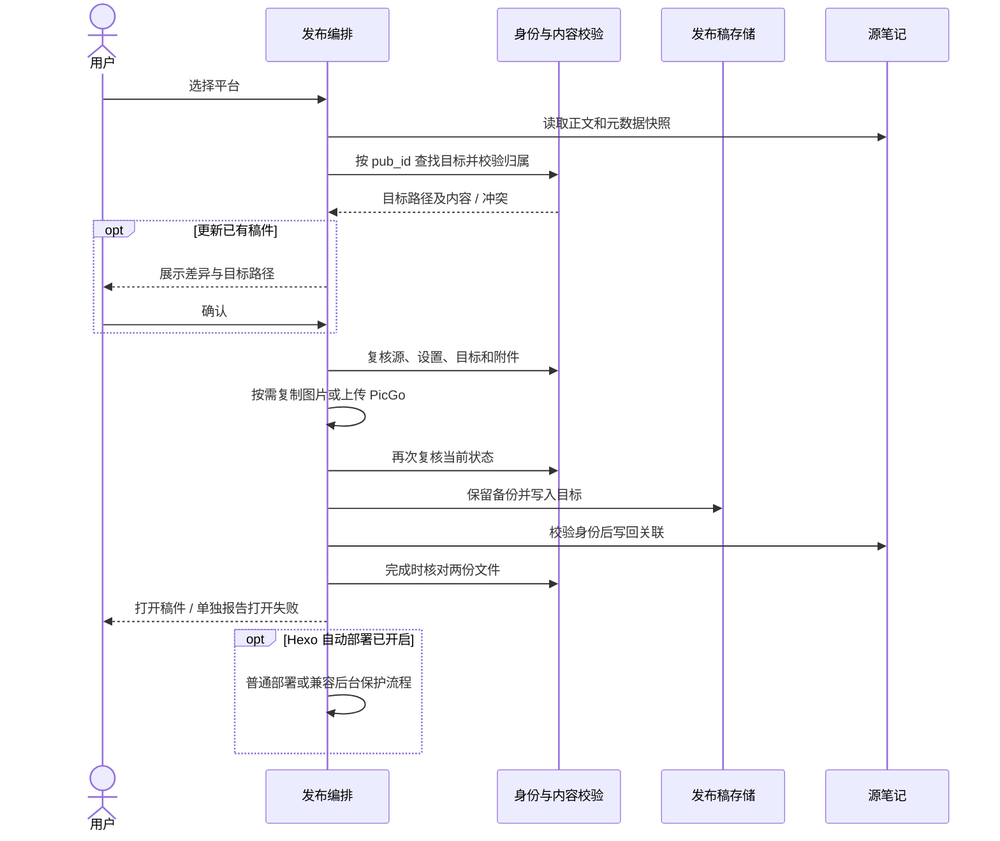
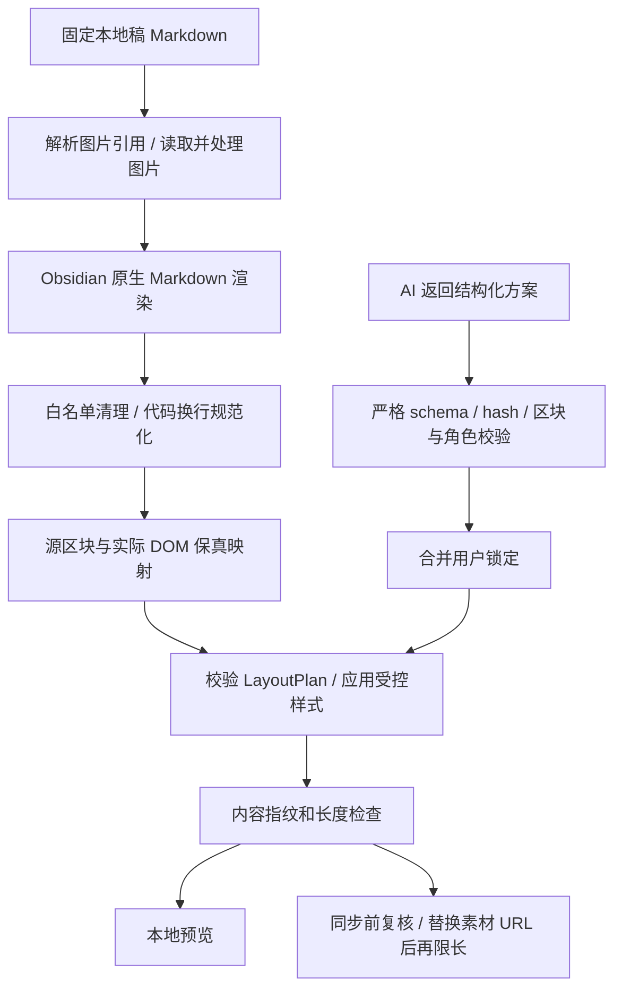
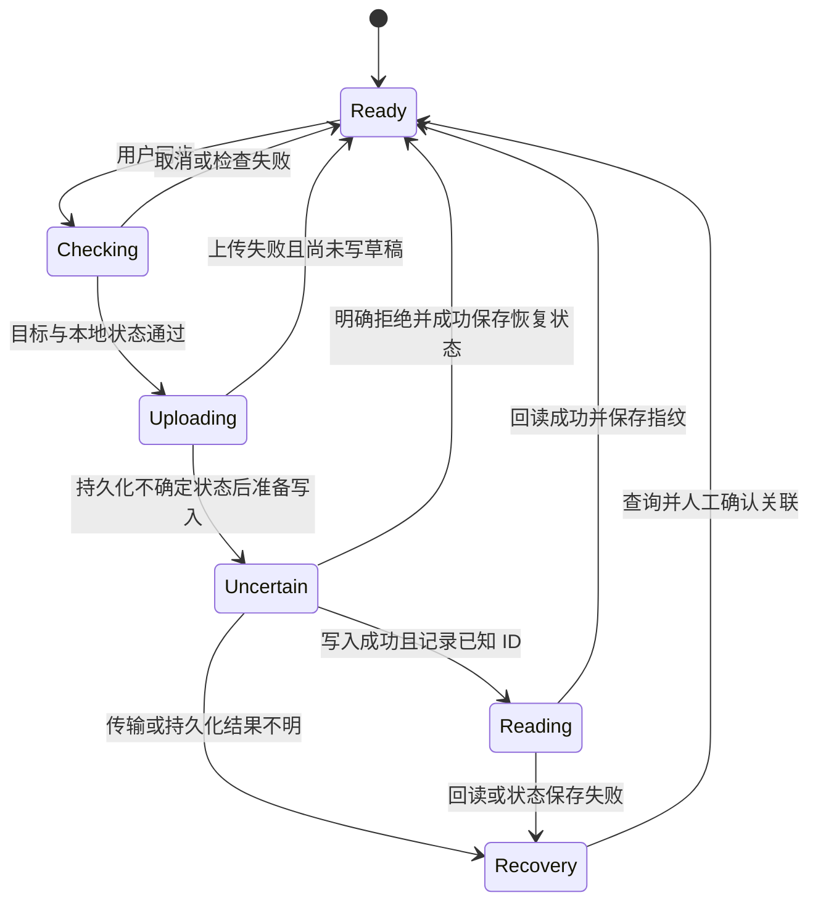

# 模块架构与关键流程

[文档首页](../README.md) · [总体架构图](../overview.md) · [数据模型](../reference/data-model.md) · [测试](testing.md)

本页面向维护者，描述当前分支实现。源稿、发布稿和远端草稿的产品语义以概览为入口；这里说明代码职责、调用顺序和不能被重构破坏的约束。

## 模块职责

| 模块 | 职责 | 边界 |
| --- | --- | --- |
| [main.ts](../../main.ts) | 生命周期、命令、设置队列、凭据会话、发布和 Hexo 编排 | 保留跨步骤检查，不把 UI 按钮状态作为唯一锁 |
| [settings.ts](../../settings.ts) | 配置入口与保存反馈 | 不实现上传或文件事务 |
| [types.ts](../../types.ts) | 平台、元数据、素材、草稿、排版结构 | 外部输入仍须运行时校验 |
| [utils/platforms.ts](../../utils/platforms.ts) | 路径、子目录、关联链接、附件目标 | Vault 相对路径与外部路径分开 |
| [utils/publishStore.ts](../../utils/publishStore.ts) | Vault/外部稿件 IO、目录遍历、备份提示 | 库内走 Vault API，外部走 fs |
| [utils/publishFiles.ts](../../utils/publishFiles.ts) | 外部协作锁、备份、原子目标写入、不可变图片 | 不替代源稿关联写回事务 |
| [utils/frontMatter.ts](../../utils/frontMatter.ts) / [publishIdentity.ts](../../utils/publishIdentity.ts) | 解析、字段合并、源归属、会话身份索引 | 兼容旧 ID，不信任缓存中的冲突结论 |
| [publishSafety.ts](../../utils/publishSafety.ts) / [publishDiagnostics.ts](../../utils/publishDiagnostics.ts) | 内容冲突校验、后台字段、目录诊断 | 诊断只读，不自动迁移 |
| [imageEmbeds.ts](../../utils/imageEmbeds.ts) / [hexoMetadata.ts](../../utils/hexoMetadata.ts) / [picgo.ts](../../utils/picgo.ts) | 语法范围内替换、封面属性、可选上传 | 不改源正文；更新确认后再产生上传副作用 |
| [hexoCommands.ts](../../utils/hexoCommands.ts) / [linkUtils.ts](../../utils/linkUtils.ts) | 本地 Hexo 校验/调用与 URL 解析 | 不临时下载 CLI |
| [controlRoom.ts](../../utils/controlRoom.ts) / [controlRoomLauncher.ts](../../utils/controlRoomLauncher.ts) | 固定协议发现、会话验证、Mac 启动 | 不绕过兼容仓库部署保护 |
| [views/HexoPreviewView.ts](../../views/HexoPreviewView.ts) | 真实文章/首页 iframe | 仅接受已验证的固定本机地址 |
| [views/WechatView.ts](../../views/WechatView.ts) | 固定稿件工作台、预览版本、表单、裁剪、同步入口 | 源稿不作为同步输入；管理窗口与保存互斥 |
| [modals/](../../modals/) | 平台选择、差异、配置、恢复、排版等界面 | 收集明确选择，异步结果必须检查有效期 |

## 普通平台发布时序

公众号初次生成也复用本地稿准备逻辑；已有公众号成稿的默认路径会直接打开，不走源正文覆盖。

实际检查分布在 `performPublish`、`copyAndOpenForEdit`、`validatePublishSource`、`updateSourceFile`、`verifyCompletedPublish` 等方法中。顺序有安全含义，不能为减少重复 I/O 而直接删除确认后的复核。

- 新目标用排他创建，已有目标检查 expected 内容。
- Hexo 备份先完整写入并同步，再以排他方式发布正式 `.bak`。
- 目标写入后源关联失败：新目标保留；已有目标仅在仍是本次写入版本时恢复。
- 目标已经写过后保留本次资源；写目标前失败才尝试清理未被文章引用的新资源。
- 完成时核对失败不再次盲目回滚，不自动部署。

这些步骤不是跨文件原子事务。协作锁不能拦住不遵守锁的编辑器；最后检查与文件替换之间仍可能有外部修改。

## 公众号渲染和排版流水线

| 模块 | 作用 |
| --- | --- |
| `wechatMarkdown.ts` | 图片引用、相对路径修正、受保护代码范围 |
| `wechatDownload.ts` / `wechatImages.ts` | 有界网络下载、格式检查、Canvas 转换、资源释放 |
| `wechatRenderer.ts` / `wechatCode.ts` | 原生渲染、清理、显式代码换行及预览图片替换 |
| `wechatLayoutAst.ts` | 源位置/hash 区块 ID、planningText 脱敏片段与 DOM 映射 |
| `wechatLayoutEngine.ts` / `wechatThemes.ts` | schema 校验、内容指纹、组件角色和本地样式 |
| `wechatLayoutPreview.ts` / `wechatLimits.ts` | 弹窗预览转换、公共长度和字段规则 |
| `wechatAiProvider.ts` / `wechatAiPlanner.ts` | 兼容请求、受限响应、锁合并和会话缓存 |
| `WechatLayoutModal.ts` | 候选、撤销、请求预览、逐块调整、显式应用 |

原始 HTML 或不可靠映射可回退为安全的标签级主题；本地附件模式在交给宿主渲染前拒绝原始 HTML。预览和同步共用规范化结果，不能另写一条看似相同但校验不同的渲染路径。

AI 请求发送 `model/messages/stream:false/max_tokens:4096`，可选 JSON response_format。服务返回 `choices[0].message.content` 的字符串，finish_reason 必须是 `stop`，内容再次解析为 LayoutPlan。模型不得返回 HTML、文章文本、未知字段或 locked。限制与数据外发范围见[安全说明](../security.md)。

## 工作台异步状态

- `version`、绑定文件、读取快照和图片策略版本用于识别过期渲染。异步读取前后都校验，关闭或修改后忽略旧结果。
- `dirty` 保护尚未保存的表单；`stale` 阻止用旧预览同步；`busy` 互斥当前工作台任务。
- 自动刷新可合并/排队；暂停会取消定时刷新，并使进行中的渲染失效。
- `layoutOpening` 在读取前占位，`layoutModal` 管理单个窗口；关闭工作台也关闭排版窗口。
- 应用方案在工作台层先取得锁，使用独立文章/历史快照，取消检查延伸到宿主 `processFrontMatter` 的同步回调。回调提交之后关闭窗口不回滚写入。
- AI 请求版本与手工调整版本分开判断：旧结果不能覆盖新选择；旧请求未结束时不再发第二个请求。

锁的作用域是单个插件/工作台实例，不是跨设备分布式锁。界面上的 disabled 只是反馈，不是唯一安全检查。

## 远端草稿同步状态

[wechatSync.ts](../../utils/wechatSync.ts) 执行状态顺序，[wechatApi.ts](../../utils/wechatApi.ts) 封装请求，[wechatReadback.ts](../../utils/wechatReadback.ts) 在成功后做内容诊断。回读成功不等于视觉显示一致；外链被平台清理会单独提示。诊断失败不应重发已经成功的写请求。

素材缓存可在草稿后续失败时保留；它与草稿事务独立。不确定状态先持久化再发写入，恢复时不能靠删除标记让“重试”创建重复稿件。

## 依赖方向与重构原则

UI 调用编排/纯转换；工具模块尽量不依赖具体弹窗。与主插件的类型关系使用 type import。公共约束集中定义，但不要为追求单个大抽象把 Hexo 外部 IO、Vault 元数据操作和微信远端协议混为同一种“保存”。

开发约束仍以 [AGENTS.md](../../AGENTS.md) 和 [CLAUDE.md](../../CLAUDE.md) 为准。新行为必须同时更新入口文档、数据/配置参考及对应测试，见[贡献约定](contributing.md)。
