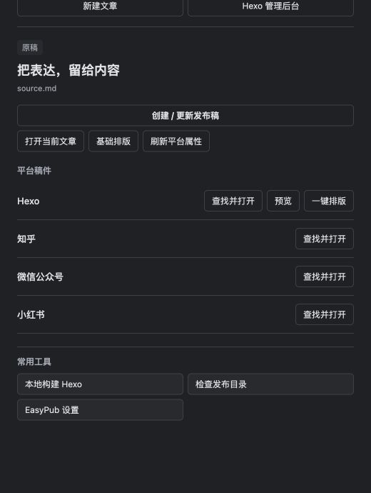

# 安装、升级与快速开始

[文档首页](README.md) · [项目概览](overview.md) · [故障排查](operations/troubleshooting.md)

先生成一份可独立编辑的本地稿，再决定是否同步或上线。本页以公众号本地稿为例；完成首次体验不需要公众号账号、图床或 AI 服务。

> [!NOTE]
> EasyPub 仅支持桌面版 Obsidian，最低版本声明为 **1.5.7**。最低版本与各系统的实际验收范围见[版本状态](status.md)。

## 环境要求

只准备你要使用的平台，其他设置可以留空。

| 要完成的事 | 需要准备 |
| --- | --- |
| 生成知乎、小红书稿；编辑和排版公众号本地稿 | 一个可以正常编辑笔记的 Obsidian Vault |
| 生成 Hexo 稿 | 已有的 Hexo 博客仓库，并在设置中填写其绝对路径 |
| 构建或部署 Hexo | 系统 Node.js、博客本地依赖，以及部署方式需要的非交互凭据 |
| 同步公众号草稿箱 | 具备相应接口权限的公众号、AppID / AppSecret、正确的出口 IP 白名单 |

PicGo 和 AI 均为可选。兼容 Blog Control Room 的博客另见[接入条件](control-room.md)。

## 安装

1. 从 [EasyPub Releases](https://github.com/threeyang3/easyPub/releases) 下载**同一版本**的 `main.js`、`manifest.json`、`styles.css`。
2. 将三个文件放入当前 Vault 的 `.obsidian/plugins/easy-pub/`：

   ```text
   你的 Vault/
   └── .obsidian/plugins/easy-pub/
       ├── main.js
       ├── manifest.json
       └── styles.css
   ```

3. 重启 Obsidian，在“设置 → 第三方插件”中启用 EasyPub。
4. 打开“设置 → EasyPub”，确认发布根目录。首次体验可保留默认的 `发布`。

启用后，点击左侧工具栏的“打开 EasyPub 发布面板”，或执行命令 `EasyPub: 打开发布面板`，即可进入常用操作。

## 第一次生成稿件

### 1. 准备一篇原稿

新建普通笔记，复制以下内容。也可以从 EasyPub 发布面板点击“新建文章”，填写标题和保存目录后创建。

```markdown
---
title: 从写作到发布
---

## 写好一篇文章

在原稿中整理想法，再为不同平台生成独立的发布稿。

发布前，检查标题、正文和配图。
```

### 2. 选择发布平台

保持原稿打开，在 EasyPub 面板点击“创建 / 更新发布稿”，选择“微信公众号”。也可执行 `EasyPub: Publish to platform` 或点击云形发布图标。



*面板跟随当前文章；“查找并打开”用于定位已有稿件，“创建 / 更新发布稿”进入生成流程。示例使用演示稿件。*

### 3. 核对属性，再确认生成

在属性窗口填写或检查标题、作者、摘要和封面，点击 **“预览属性变更” → “确认并继续”**。本地体验可以先不设置封面；同步微信前再补齐。

首次生成后，EasyPub 会打开公众号工作台。点击“打开本地稿”可回到 Markdown 编辑器，继续修改这份平台稿。

| 选择的平台 | 默认保存位置 | 生成后的入口 |
| --- | --- | --- |
| 微信公众号 | `发布/微信公众号/` | 公众号工作台 |
| 知乎 | `发布/知乎/文章/` 或 `想法/` | Obsidian 中的平台稿 |
| 小红书 | `发布/小红书/` | Obsidian 中的平台稿 |
| Hexo | 博客仓库 `source/_posts/` | Obsidian 中的外部 Markdown 稿 |

> [!TIP]
> 看到独立的本地稿件，就已完成第一次生成。**本次公众号本地稿的生成不会写入微信草稿箱。**Hexo 自动部署默认关闭；主动开启后的行为见[发布机制](publishing.md)。源文章和平台稿通过 `pub_id` 关联；缺失 ID 时由 EasyPub 自动补齐，无需手动填写。

<details>
<summary>原稿与平台稿的属性怎样分开维护？</summary>

新平台稿只继承允许的基础属性。更新正文时，已有平台稿保留自己的标题、标签、封面等设置。

需要先整理原稿属性时，执行 `EasyPub: 初始化原稿属性`。需要以后从原稿更新平台属性时，执行 `EasyPub: 从原稿刷新平台属性（选择字段）`，逐项选择并预览；此操作保留平台正文与首次日期。

原稿保留 `pub_id`、`子文件` 等源稿信息，平台稿保留 `source_file` 关联。完整规则见[属性归属](reference/data-model.md#属性归属)。

</details>

## 博客的下一步

1. **编辑稿件。**生成后直接在 Obsidian 中编辑对应的外部 Hexo Markdown 文件；已打开的稿件会复用原标签页。文件仍保存在博客仓库，EasyPub 不自动挂载目录到 Vault。
2. **核对已保存版本。**有兼容后台时，从原稿执行“预览 Hexo 发布效果”。预览读取博客中的已保存稿件，源文章中新写但尚未导出的内容不会出现在其中。
3. **构建，再部署。**自动部署默认关闭。普通博客可先本地构建再部署；兼容 Blog Control Room 的博客进入后台完成受保护发布流程。

如果宿主不能原生打开外部文件，插件会提示升级或使用已有的目录挂载。更详细的编辑和图片粘贴方式见[发布面板指南](publishing-workbench.md)。

从公众号成稿生成博客时，使用工作台的“生成 Hexo 稿”，选择普通 Markdown 或保留公众号排版；新稿进入 `_drafts`。详见[两种生成方式](wechat-association.md#从公众号稿生成-hexo-稿)。

## 公众号的下一步

1. 在公众号本地稿中完成平台专用修改，工作台会更新正文预览。
2. 使用“基础排版”整理 Markdown 缩进和空行，或用“智能排版”选择本地主题。两者的区别见[排版指南](wechat-layout.md)。
3. 在“文章信息”“图片与封面”中核对内容，修改后点击“保存设置并刷新”。
4. 通过账号向导配置公众号并运行只读检查，补齐封面后点击“同步草稿箱”。
5. 到公众号后台及手机预览中检查效果，再自行发布。

已有公众号稿件默认只打开，不重新导入原稿。需要用原稿替换正文时，使用“从源文章更新公众号本地稿（确认后替换正文）”并核对差异。完整步骤见[公众号工作台](wechat.md)。

## 升级与回退

升级时结束正在进行的同步、发布和设置保存，备份插件目录中的 `data.json` 及需要保留的稿件。停用 EasyPub，替换同一版本的三个安装文件，再重新启用。

**保留你自己的 `data.json`。**它包含配置、缓存和草稿关联，不要用其他 Vault 的文件覆盖。版本号可在插件管理页确认；从源码构建不会自动更新 Vault 内插件。

回退同样需要完整的同版安装文件。旧版未必识别新配置，先在备份副本中验证；不要删除未知字段强行降级。迁移电脑后，系统加密凭据可能需要通过向导重新输入。详见[备份、恢复与迁移](operations/backup-and-recovery.md)。
