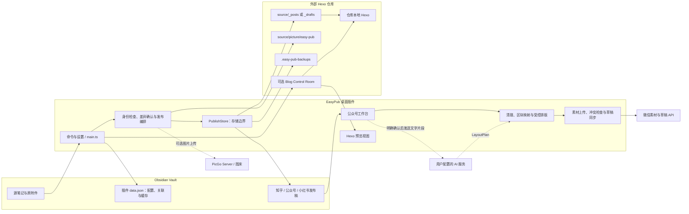

# 项目概览

[文档首页](README.md) · [快速开始](getting-started.md) · [详细架构](development/architecture.md)

EasyPub 是桌面端 Obsidian 插件，把一篇源笔记转换为不同平台的独立发布稿，并提供 Hexo 预览/部署入口和微信公众号草稿工作台。核心目标是让内容保留在可编辑的本地文件中，同时明确区分“准备稿件”“同步远端草稿”和“正式发布”。

本文描述当前代码分支。版本号及稳定版与待发布改进的区别见[版本与验证状态](status.md)。

## 能力与边界

| 平台 | 本地输出 | 预览与后续动作 | 最终发布 |
| --- | --- | --- | --- |
| Hexo | 外部博客仓库中的 Markdown | 本地构建；兼容 Blog Control Room 时可在 Obsidian 中看真实主题页面 | 普通仓库可调用 Hexo 部署；兼容仓库进入后台保护流程 |
| 知乎 | Vault 内文章/想法稿 | 在 Obsidian 编辑；可选 PicGo 图片转换 | 用户自行操作平台 |
| 微信公众号 | Vault 内独立成稿 | 正文、图片、双比例封面、十二套风格与可选 AI 排版；同步微信草稿箱 | 用户在公众号后台预览和发布 |
| 小红书 | Vault 内 Markdown 稿 | 在 Obsidian 编辑；可选 PicGo 图片转换 | 用户自行操作平台 |

EasyPub 不自动向知乎或小红书发帖，不执行公众号群发，不把后台修改自动合并回源笔记。AI 仅规划排版，不生成新正文或任意 HTML/CSS。默认关闭 Hexo 自动部署。

## 总体架构图

图中实线表示主要数据或调用路径，虚线表示可选能力。Obsidian Vault 与博客仓库是两个独立存储边界。



插件通过 Node fs 直接读写外部博客，通过 Vault API 读写库内稿件；安装在 Vault 中不意味着只能访问 Vault 内文件。后台管理页在系统浏览器打开，真实文章预览由插件中的 iframe 显示。

## 四个关键概念

| 概念 | 含义 | 编辑后影响 |
| --- | --- | --- |
| 源文章 | 用户最初打开并准备分发的笔记 | 下次主动生成/更新时才影响对应稿件 |
| 发布稿 | 针对某个平台生成的独立 Markdown 文件 | 可以继续编辑；不自动反写源文章 |
| 远端草稿 | 微信公众号草稿箱中的图文 | 与本地稿分开存储，同步前检测冲突 |
| 发布结果 | 博客部署后的站点或平台正式内容 | 与“保存本地稿”“保存草稿箱”不同 |

`pub_id` 关联同一篇文章的不同稿件；它不是文件名，也不是博客的 `abbrlink` 或微信的 `mediaId`。详见[数据模型](reference/data-model.md)。

## 文件在哪里

以下为示意路径，目录通常在需要时创建，不要求 Vault 与博客仓库嵌套：

```text
Obsidian Vault/
├── 笔记/文章.md                       # 源文章，可位于任意普通笔记目录
├── 附件/封面.png                      # 原附件保留
├── 发布/                             # publishBasePath，可配置
│   ├── 知乎/文章/文章.md
│   ├── 知乎/想法/文章.md
│   ├── 微信公众号/文章.md
│   └── 小红书/文章.md
└── .obsidian/plugins/easy-pub/
    ├── main.js / manifest.json / styles.css
    └── data.json                     # 运行数据，不是文章仓库

Hexo 仓库/                             # hexoRepoPath，独立绝对路径
├── source/
│   ├── _posts/文章.md                 # 新建 Hexo 稿件默认位置
│   ├── _drafts/文章.md                # 已有关联稿件会保留所在状态/目录
│   └── picture/easy-pub/<pub_id>/     # 复制后的博客图片
├── .easy-pub-backups/                 # 覆盖前全文备份
└── .blog-admin/control-room.json     # 兼容后台的临时会话，非所有仓库都有
```

### 外部博客稿件如何打开和预览

- “打开发布稿”对外部文件调用系统默认编辑器，不会自动把它加入 Obsidian 文件列表。
- 从源文章执行“预览 Hexo 发布效果”，插件按 `pub_id` 找到博客里的已保存稿件，调用兼容后台渲染，在 Obsidian 中显示页面。
- EasyPub 本身不创建目录挂载或符号链接。第三方目录挂载工具属于独立配置；不能假定挂载后的内部路径与 EasyPub 的外部路径跳转已经联动。
- 如果管理后台和 EasyPub 配置的是同一个博客目录，二者修改的是同一份发布稿，不需要复制回另一份“Obsidian 博客稿”。后台或发布稿的改动不会自动回写源笔记。

## 典型工作流

### 博客

源笔记 → 生成/确认更新 Hexo 发布稿 → 编辑博客稿 → 预览已保存内容 → 构建或进入管理后台 → 部署。

从源文章重新更新可能替换博客稿中的平台专用正文修改，必须查看差异。当前不是双向同步或三方合并系统。

### 公众号

源笔记 → 首次生成本地稿 → 编辑本地稿 → 工作台检查 → 可选排版与封面裁剪 → 同步微信草稿箱 → 微信后台/手机预览 → 人工发布。

已有公众号稿件默认只打开，不用源文章覆盖。只有显式的“从源文章更新公众号本地稿”命令才会在确认后替换正文。

## 为什么要保留这些边界

- 身份和差异检查防止把同名稿件误当成同一篇文章。
- 确认后再次检查源文、目标、配置和附件，防止把过期预览写入文件。
- 博客覆盖前保存备份；源稿关联更新失败时优先保留可恢复内容。
- 微信远端写入结果不确定时先阻止重复创建，要求查询和恢复关联。
- 排版只改变受控样式，AI 无权修改正文、顺序或执行代码。

这些措施减少误覆盖，但不构成跨文件数据库事务或对所有外部编辑器的文件锁。细节见[架构](development/architecture.md)、[安全边界](security.md)和[恢复指南](operations/backup-and-recovery.md)。
