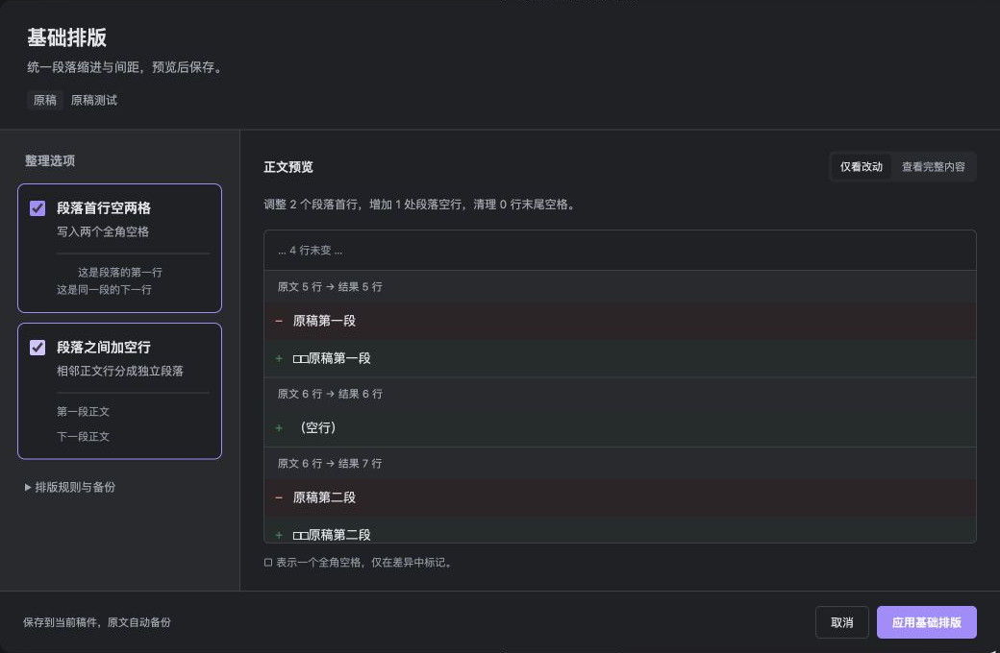

<a id="发布面板与-hexo-排版"></a>

# 发布面板与正文整理

[文档首页](README.md) · [快速开始](getting-started.md) · [发布机制](publishing.md)

发布面板负责定位稿件、进入各平台操作，以及整理本地正文。源文章、平台稿和远端草稿分别维护，操作前先看清当前文章与目标路径。

## 打开与定位稿件

点击工具栏“打开 EasyPub 发布面板”，或执行 `EasyPub: 打开发布面板`。面板默认跟随当前 Markdown 文章；需要切换标签查看资料时，可以点击“固定稿件”，完成后再取消固定。

| 入口 | 用来做什么 |
| --- | --- |
| 新建文章 | 创建独立原稿，填写标题、保存目录与基础属性 |
| 创建 / 更新发布稿 | 从当前原稿进入平台选择和属性确认 |
| 查找并打开 | 按文章身份定位已有的平台稿，找到后直接打开 |
| 基础排版 | 整理当前原稿或平台稿的 Markdown 正文 |
| 刷新平台属性 | 从原稿选择要刷新的标题、标签、封面等字段 |
| Hexo 管理后台 / 本地构建 Hexo | 进入博客管理或运行本地构建 |

“查找并打开”未找到稿件时会变为“创建稿件”，再次点击才进入创建流程。查找不会自动生成文件。没有打开文章时，博客管理、构建、目录检查和设置仍可使用。

Hexo 稿保存在博客仓库，但会在 **Obsidian 内编辑**；已打开的文件复用原标签页。知乎、小红书打开 Vault 内稿件，公众号进入独立工作台。Hexo 管理后台用于素材管理、源码同步与部署，是另一项独立操作。

<details>
<summary>面板如何区分原稿与平台稿？</summary>

平台稿通过 `source_file` 返回原稿，通过 `pub_id` 查找关联稿件。打开前会重新核验身份；关联失效、ID 不一致或指向另一平台稿时会显示提示。切换到图片附件不会替换面板文章，平台选择窗口也会固定打开时的原稿。

稿件状态按需查询，正文保存不会扫描所有平台。首次启用发布面板时会展示一次，之后由 Obsidian 工作区恢复开关状态。

</details>

## 基础排版

在原稿或任一平台稿的发布面板点击“基础排版”；公众号工作台顶栏也有同一入口。未生成 `pub_id` 的普通原稿同样可用。



*先选择整理项，再核对右侧改动。“查看完整内容”可切换前后全文；确认前不会改写正文。示例使用演示稿件。*

| 整理项 | 保存后的变化 |
| --- | --- |
| 段落首行空两格 | 在普通段落首行写入两个全角空格；已有首行空格统一为两个 |
| 段落之间加空行 | 将相邻的普通正文行分成段落，并清理普通正文行尾空格和文末多余空行 |

1. 分别勾选需要的整理项。两项同时选择时，先分段，再缩进。
2. 核对改动数量与差异；`□` 代表一个全角空格，保存时写入实际空格。
3. 点击“应用基础排版”保存当前稿件，或点击“取消”放弃本次整理。

重复应用不会叠加缩进或空行。只选首行缩进时，同段续行保持不变；选段间空行时，普通正文的软换行和显式硬换行都会转为空行分段。

> [!NOTE]
> 基础排版会直接修改 **Markdown 正文**，只处理当前稿件，不自动同步其他稿，也不回写关联原稿。公众号主题与卡片属于另一种排版配置，见[主题与智能排版](wechat-layout.md)。

<details>
<summary>哪些内容会保留？原文备份在哪里？</summary>

标题、代码、列表、引用、表格、HTML、数学块、Obsidian 注释、Hexo 成对标签和独立图片行保留原结构。已导出的 HTML 排版正文不会被转换为普通 Markdown。公众号已有区块排版会按正文变化重新匹配，窗口会提示需要重新确认的组件。

保存前会核对稿件路径、磁盘内容及编辑器中尚未保存的修改，并保留全文备份：

- Vault 内原稿和平台稿：插件目录 `formatting/backups/`。
- 外部 Hexo 稿：博客根目录 `.easy-pub-backups/`。

可在窗口“排版规则与备份”中查看具体路径。需要恢复时先核对备份原文，再手动恢复对应稿件。

</details>

## 在发布稿之间同步正文改动

当一份平台稿已补充文字或配图，可以把选中的改动同步给其他**已有**平台稿。打开发起稿，点击发布面板的“同步正文改动到其他稿”；公众号工作台中对应入口为“同步正文到其他稿”。命令面板也提供“将本稿改动同步到其他发布稿”。

1. **选目标。**勾选已有的平台稿；此操作不新建稿件，也不修改原稿。
2. **选改动。**选择正文变化，或切换“仅新增配图（独立图片行）”。相邻的文字变化和新增图片可以分开选择。
3. **看冲突。**核对目标当前片段与替换内容。重叠的独立修改默认不选，明确选中才会替换。
4. **预览并确认。**点击“预览所选改动”，查看目标最终完整正文，再确认同步。更改勾选后需要重新预览。

同步只保存本地稿，不创建微信远端草稿，不构建或部署博客。目标已有的相同改动不会重复应用，目标独有的其他段落、标题、封面和自定义属性保留。

<details>
<summary>比较基准、图片路径与备份规则</summary>

首次比较以**当前原稿**为基准，不推断生成以来的历史操作，因此差异可能包含平台特定内容，需逐项核对。后续按“本稿 → 各目标稿”的独立记录比较：只有已确认的改动进入基准，未选中的改动下次仍可选择。

图片按内容哈希比较，避免把路径转换误认为换图。Hexo 本地图同步到其他平台时，必要文件导入当前 Obsidian 附件目录，并生成相对目标稿的引用；已有 Vault 附件复用。同步到 Hexo 时，图片复制到 `source/picture/easy-pub/<pub_id>/`。可验证的 PicGo 缓存能识别同一原图，其他网络图片保留网址；同步不会下载网络图片或上传图床。代码示例中的图片语法不视为配图。

预览后，原稿、发起稿、目标、图片或附件设置发生变化时，需要重新检查。每份目标写入前都保留备份；多目标部分失败时会列出已完成的平台，并保留已导入图片，重新打开窗口后再核对其余稿件。

比较基准和原文备份位于插件目录 `draft-sync/baselines/` 与 `draft-sync/backups/`，包含本地文章内容，不是微信远端版本库，也不会自动清理。公众号排版保留规则见[主题指南](wechat-layout.md)。

</details>

### 跨稿同步中断后的基准恢复

如果正文已保存、但基准记录写入失败，窗口会列出已完成稿件与恢复记录路径。重新打开同步窗口后，插件会核对目标正文并恢复基准，避免重复应用已完成的改动。

若记录损坏，或目标又被其他编辑器修改，自动恢复会停止。保留记录，先核对全文备份，不要直接删除未知状态的基准文件。图片恢复按每次引用的位置保留目标原有路径，同字节、不同路径的附件分别校验。

## 在 Hexo 稿件中粘贴图片

在 Obsidian 内的 Hexo 稿正文粘贴图片，插件会保存到博客的：

```text
source/img/uploads/年/月/pasted-内容哈希.扩展名
```

然后在光标位置插入站内图片链接。同内容图片复用文件，不覆盖其他素材；原生外部稿与 FolderBridge 映射稿均适用。阅读模式和实时预览会解析博客本地图片，正文保持可发布的链接。

这项处理仅针对已配置博客中的 `source/_posts` 和 `source/_drafts`。原稿、其他平台稿及普通笔记仍使用原有附件设置；不会改动全局附件目录，也不会上传图床或部署。

支持 PNG、JPEG、GIF、WebP，单张最多 8 MB，可一次粘贴多张。保存期间可继续输入；若覆盖了粘贴位置、切换稿件或修改博客路径，图片会保留在素材库，但不会插入错误位置。保存失败会提示原因，不插入无效链接。

## Hexo 一键排版

Hexo 操作行的“一键排版”保留原有规则：把普通正文的相邻行分段，并清理正文行尾空格和文末多余空行。例如：

| 修改前 | 排版后 |
| --- | --- |
| `第一行`<br>`第二行` | `第一行`<br>空行<br>`第二行` |

软换行和显式硬换行都会转换为空行分段。结构化内容保留，重复执行不增加空行；混有复杂扩展语法的段落保守处理。

确认窗口展示目标路径、改动数量和差异，也可切换“查看完整内容”。点击“应用排版”后，只保存关联的 Hexo 稿，不回写原稿或触发部署。原稿、博客配置、稿件身份或内容变化时，需要重新操作；关闭窗口会在文件替换前取消保存。

备份位于博客根目录 `.easy-pub-backups/`，可从 EasyPub 设置中的发布稿备份入口查看原文并手动恢复。需要同时整理首行缩进时，可改用上方[基础排版](#基础排版)。

## 公众号工作台

公众号工作台默认在中央标签页打开。通过“正文预览”“文章信息”“图片与封面”切换；宽度达到 850px 时，可点击“并排预览与设置”同时查看两栏，窄窗口保持单页。

在“图片与封面 → 调整封面裁剪”中分别调整 **2.35:1** 横版和 **1:1** 方形构图。取消会放弃本次裁剪；应用后再点击“保存设置并刷新”。原始附件保持不变，同步微信草稿箱仍是独立操作。

裁剪、主题排版或基础排版进行期间，不能切换绑定稿件。正文、图片或读取策略变化后，过期的裁剪和预览不能直接保存。同步条件不满足时，工作台底部会列出原因及处理入口。完整流程见[公众号指南](wechat.md)。

## 生成稿件时添加图片

生成发布稿的属性窗口支持“上传图片”“选择已有附件”，也可以在“图片附件 → 添加图片附件”中批量导入，再用作封面、Hexo 顶部图片或复制正文引用。初始化原稿属性和刷新平台属性也提供这些入口。

导入图片按原稿位置与 Obsidian 附件设置保存，同名文件自动换新名称，不覆盖原附件。支持 JPG、PNG、GIF、WebP、AVIF、BMP、SVG，单张最多 50 MB；各发布平台还会检查自己的格式和大小要求。

导入期间暂缓属性确认，完成后需重新预览。取消生成会停止后续导入，已保存附件保留。导入只保存本地文件，后续复制到博客或上传素材仍沿用各自发布流程。
