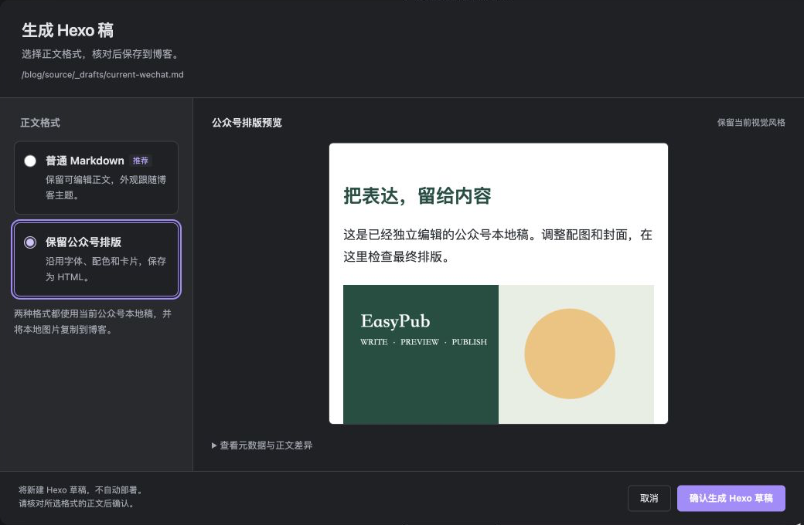

# 公众号与 Hexo 联动

[文档首页](README.md) · [公众号工作台](wechat.md) · [主题与智能排版](wechat-layout.md) · [发布工作台](publishing-workbench.md)

同一篇文章可以在公众号和博客分别成稿。EasyPub 用 `pub_id` 识别它们，在明确确认后生成正文或同步关联；**生成、部署博客和正式发布公众号文章分别操作**。

| 你想完成的事 | 使用哪个入口 |
| --- | --- |
| 把公众号成稿带到博客 | 工作台「生成 Hexo 稿」，选择普通 Markdown 或保留公众号排版 |
| 在公众号底部放博客链接 | 「文章信息 → 阅读原文」，可自动带入同篇 Hexo 网址 |
| 在博客中关联正式公众号文章 | 「文章信息 → 公众号文章关联 → 关联已发布文章」 |

## 从公众号稿生成 Hexo 稿

**两种方式都读取当前公众号本地稿正文**，包括其中的独立修改、缩进和空行；不会改用原稿，也不从微信后台下载正文。无需先连接公众号账号或选好封面。



*切换正文格式后，先检查新的预览，再确认生成。示例稿件仅演示本地操作。*

| 正文格式 | 保存结果 | 适合什么情况 |
| --- | --- | --- |
| **普通 Markdown（默认）** | 可继续编辑的 Markdown，外观由博客主题控制；不注入公众号主题样式 | 继续写作、跟随博客主题或跨平台复用 |
| **保留公众号排版** | `.md` 正文中保存带内联样式的 HTML，并引用独立 CSS 文件 | 希望延续当前公众号字体、配色、卡片和段落效果 |

1. 先保存工作台设置并刷新，点击「生成 Hexo 稿」。
2. 选择「普通 Markdown」或「保留公众号排版」。
3. 核对顶部博客路径和正文预览，展开「查看元数据与正文差异」。
4. 点击「确认生成 Hexo 草稿」；已有同篇稿件时，按钮为「确认更新 Hexo 稿」。
5. 按[博客发布流程](publishing.md)构建并预览效果，再决定部署；使用兼容后台的仓库也可进入 [Blog Control Room](control-room.md) 检查与发布。

尚无同一 `pub_id` 的 Hexo 稿时，新建到 `_drafts`；已有唯一匹配时，更新原位置的正文，保留分类、标签、日期、`abbrlink` 和已有公众号关联等博客设置。不会为同一篇文章重新建第二份稿件。

两种方式都会把本地图片复制到博客的 `source/picture/easy-pub/{pub_id}`。普通 Markdown 保留本地附件原始图片字节，**网络图片仍使用原 URL**；保留排版模式则复制预览中处理后的图片。新稿存在封面时会带入处理后的封面。

保留排版模式会保存字体、主题色、段落间距、卡片、引用、列表、表格和代码换行；博客外框、页面宽度、目录及主题附加效果仍需在实际博客检查。普通「同步正文到其他稿」同步的是 Markdown 正文，会替换已生成的 HTML 排版正文；需要保留视觉效果时，应再次使用「生成 Hexo 稿 → 保留公众号排版」。

<details>
<summary>生成时的保存与保护规则</summary>

预览和切换格式不写文件，取消不创建稿件；最终确认只保存当前选择的结果。公众号本地稿及其排版方案保持不变，原稿正文也不变，只补齐原稿的既有子稿关联。

同名但不同 `pub_id` 的文件会另取文件名。确认写入沿用备份、原子替换和身份／字节检查；稿件、图片、原稿或博客配置发生变化时，需要重新生成预览。

生成不自动部署，即使其他发布操作启用了自动部署。生成后刷新工作台，可按下节规则补齐尚未设置的「阅读原文」。公众号公开文章链接仍需正式发布后回填。

</details>

## 自动填写「阅读原文」

「阅读原文」指向博客；「公众号文章关联」指向正式发布的公众号文章，它们是两个独立地址。

先生成同一原稿的 Hexo 稿，再生成公众号稿，属性确认窗口会自动带入 Hexo 网址，可修改或清空。若先有公众号稿、后有 Hexo 稿，打开或刷新工作台也会补齐尚未设置的「阅读原文」。

自动填写支持 `_posts` 和 `_drafts`，从当前 `_config.yml` 与稿件固定链接字段计算，不使用旧 `publish_url`，无需先构建。**能计算网址不代表博客已上线**，请部署后打开链接确认。

已有链接、主动清空后保存的空值都会保留，后续正文更新或博客配置变化不会覆盖。工作台预览不写文件；点击「保存设置并刷新」或执行既有同步流程时才保存。

<details>
<summary>无法自动填写，或希望重新计算</summary>

未配置博客仓库时保持为空；无匹配、重复身份、无法读取稿件、无效文件头或固定链接不能计算时，插件不猜测网址，工作台会说明原因。解决问题后刷新，或手动填写。

如需重新自动计算，可从公众号本地稿文件头中删除 `wechat.sourceUrl` 后刷新。仅将它设为空字符串会保留“主动清空”的选择。

</details>

推荐顺序：**生成 Hexo 稿 → 核对「阅读原文」→ 部署博客并检查链接 → 发布公众号文章 → 回填公众号公开 URL → 再次部署博客**。

## 关联正式发布的公众号文章

公众号后台正式发布后，复制公开文章 URL。草稿 mediaId 不能代替公开链接；此操作不修改微信远端文章。

1. 从公众号本地稿打开工作台，到「文章信息 → 公众号文章关联」。先保存或放弃未保存的表单修改。
2. 点击「关联已发布文章」，粘贴文章链接。
3. 留言状态默认「未知」。仅在自己核实文章开放留言后，选择「已确认开放留言」。
4. 点击「下一步：预览关联」，核对公众号 URL、博客标题、绝对路径和原／新元数据，再点击「确认保存并同步」。
5. 用「查看公众号文章」手动核验可访问性，再按现有博客发布门禁检查、构建与部署。

支持 HTTPS `mp.weixin.qq.com/s/…`，以及包含 `__biz`、`mid`、`idx`、`sn` 的 `/s?…` 链接；最长 2048 字符，保留访问参数，支持 `#rd`、`#wechat_redirect`。格式验证不代表文章仍存在、所有人可读或可留言。

已有链接时，工作台提供查看、复制、修改、取消关联及「重新同步至 Hexo」。写入前会展示差异并要求确认。取消关联只删除本地和博客中的关联字段，不删除文章或正文。

## 元数据及状态

| 公众号本地稿字段 | 用途 | Hexo 对应字段 |
| --- | --- | --- |
| `wechat.sourceUrl` | 公众号底部「阅读原文」地址 | 不属于公众号文章关联字段 |
| `wechat.publishedUrl` | 正式发布的公众号公开 URL | `wechat_article_url` |
| `wechat.commentsEnabled` | 已核实的留言状态，缺省为未知 | `wechat_comments_enabled` |

| 状态 | 含义与操作 |
| --- | --- |
| 未关联／尚未关联 | 尚无关联；尚无 Hexo 稿也是正常的准备状态 |
| 已关联 | 本地和 Hexo 的关联字段一致 |
| 关联待同步 | 两边字段不同；检查后使用「重新同步至 Hexo」 |
| 目标不存在 | 已有公众号链接，但找不到对应 Hexo 稿，或仓库尚未配置 |
| 关联冲突 | 重复 `pub_id`、文件不可读或文件头无效，先解决提示的问题 |

状态在加载或刷新文章信息时重新检查，外部改动后请刷新。它不是远端文章的可访问性检查。

<details>
<summary>文件头示例</summary>

```yaml
pub_id: stable-identity
wechat:
  sourceUrl: https://example.com/blog/example-post/
  publishedUrl: https://mp.weixin.qq.com/s/example-article
  commentsEnabled: true
```

示例链接均为合成数据，不是默认配置。`commentsEnabled` 只在核实后填 `true` 或 `false`；未知时不填写。

</details>

## 一致性与恢复

只按 `pub_id` 递归查找 Hexo 的 `_posts` 和 `_drafts`，并要求唯一匹配，不按标题、文件名或旧子文件路径猜测。旧文章没有身份时，先通过既有的显式身份流程处理。

如果出现「部分完成」，说明本地关联可能已经保存，而 Hexo 写入失败。修复原因后点击「重新同步至 Hexo」，重新核对预览并确认；重启后仍可根据双方元数据找出差异。

正文更新、属性刷新、改名或草稿转正式稿会保留关联。取消关联只删除本地 `publishedUrl/commentsEnabled` 和 Hexo 的两个对应字段；不改 `abbrlink`、正文及其他字段。

<details>
<summary>写入顺序与备份</summary>

确认后，先用 `Vault.process` 比较并保存当前本地稿，再由 PublishStore 写入 Hexo。正式写入前重新核对本地字节、稿件上下文、仓库路径和全量唯一匹配；Hexo 沿用锁文件、全文哈希备份、临时文件和原子替换。

这不是跨文件系统原子事务。本地成功而 Hexo 失败时，不会把本地关联静默回滚。手动修改 Hexo 关联字段后再同步，也会显示旧值，避免无提示覆盖。

备份位于既有 `.easy-pub-backups`，可能含未公开全文。恢复与隐私注意事项见[备份与恢复](operations/backup-and-recovery.md)。

</details>

## 手动验收

正式使用前，选用自己已发布且确认可公开访问的文章：关联后检查公众号与 Hexo 字段，确认「阅读原文」和 `abbrlink` 不变；构建博客后，在桌面、手机和深色模式检查同一篇文章入口与留言提示。

本地测试和示例截图不代替真实账号、博客部署与移动端验收。开发测试入口和覆盖范围见[测试指南](development/testing.md)，历史记录见[版本状态](status.md)。

<details>
<summary>回归检查清单</summary>

- 同一源笔记生成两种本地稿，确认 `pub_id` 相同，正式 URL 不是草稿 ID。
- 关联确认前修改博客文件，操作应停止或报告部分完成，不覆盖外部编辑。
- Hexo 写入失败后，本地信息保留；修复后刷新、重新同步。
- 更新正文、标题、文件名，将 Hexo 草稿转正式稿，仍能查到关联。
- 取消后只删除四个关联字段，恢复正文历史不应复活已取消关联。
- 留言 `true`、`false`、未知分别核对文案；无 URL、非法 URL、加密文章不出现组件。

</details>

## 定位性能和状态刷新

<details>
<summary>查询复用与写入复核</summary>

「阅读原文」和关联状态复用共享 Hexo 定位服务，以版本索引合并同时发起的相同查询。每次刷新仍枚举目录以发现新增稿件；热查询只重读匹配稿，未知版本则重新读取。

关联状态仅在工作台刷新时更新；重新提取摘要、更换封面或重建表单不会重新查询整个博客。确认写入前仍严格重读全部身份并核对目标字节。

</details>
