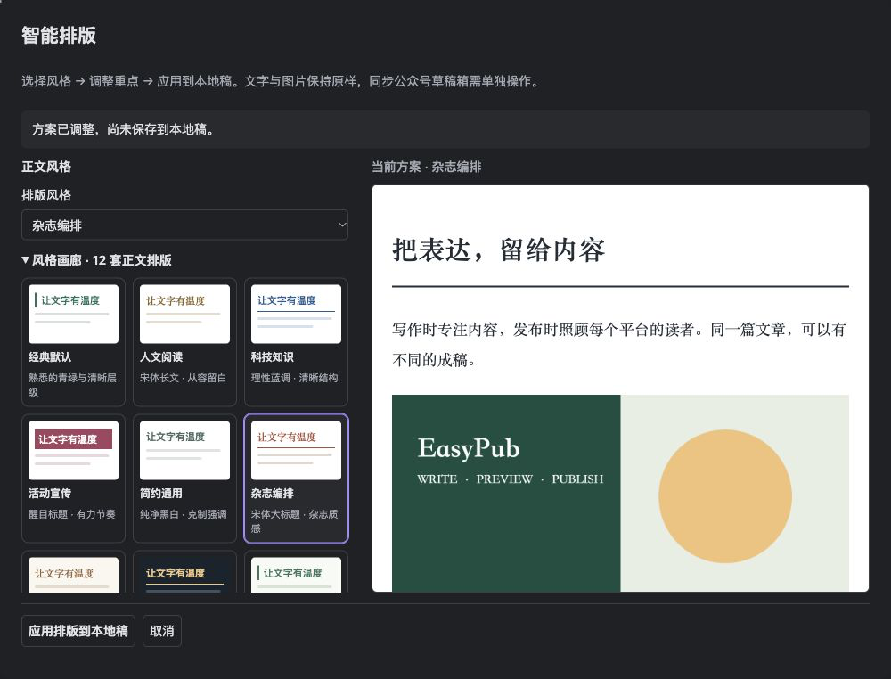

# 公众号主题与智能排版

[文档首页](README.md) · [公众号工作台](wechat.md) · [基础排版](publishing-workbench.md#基础排版)

先选一套本地风格，再调整需要强调的段落。十二套风格无需 AI 或 API Key；AI 仅用于建议主题与区块组件。

*先在预览中比较，再点击「应用排版到本地稿」。图中使用示例稿件，不代表真实公众号账号或手机端验收。*

> 「智能排版」保存主题和组件配置，**不会向 Markdown 正文插入样式代码**。如果希望正文实际写入两个全角空格或段间空行，请使用「基础排版」。

## 使用

1. 从公众号本地稿打开工作台，先保存文章信息、封面设置并处理预检问题。
2. 点击「智能排版」，在「正文风格」选择风格；选择后会立即显示完整正文预览。
3. 保持「跟随风格配色」，或另选强调色。用「对比默认 / 当前方案」比较效果。
4. 需要突出某个段落时，展开「逐块调整与锁定」，选择导语、重点卡片、引文或总结组件。
5. 核对后点击「应用排版到本地稿」。关闭或取消会放弃尚未应用的候选方案。
6. 准备发送到微信时，再回工作台点击「同步草稿箱」。

本地应用、切换主题和 AI 请求都不会自动上传图片或写入微信。应用时会检查最终 HTML 长度，超限方案无法保存或同步；若仅因旧排版超限，仍可打开本窗口换用更精简的风格或恢复默认。

### 可选风格

- 经典默认 · 人文阅读 · 科技知识 · 活动宣传
- 简约通用 · 杂志编排 · 温柔奶油 · 深夜电台
- 轻盈花园 · 蓝调手记 · 朱砂书卷 · 黑白档案

每套风格分别设计字体、标题、留白及组件。风格画廊展示配色和标题缩略样式，文章预览用于核对完整效果。

### 调整重点、锁定与撤销

| 操作 | 作用 |
| --- | --- |
| 逐块调整 | 段落、列表、引用可改为导语、重点卡片、引文或总结；标题、代码、表格、图片保持原结构 |
| 锁定此区块 | 新 AI 方案或候选方案切换时，保留该区块组件 |
| 撤销本次调整 | 撤销当前窗口最近 20 步调整 |
| 候选与历史 | 选择当前正文可用的已保存方案，最多保留最近 5 个应用版本 |
| 恢复默认排版 | 显式清除当前组件设置，恢复默认主题方案 |

预览标题会注明当前风格或默认模板对比；应用按钮始终保存当前选择的方案。保存过程中不能重复应用或继续修改，同一工作台只打开一个排版窗口。

## 配置 AI 服务

AI 是可选能力。只使用本地主题和手工组件时，可以跳过这一节。

1. 在排版窗口或插件设置点击「配置 AI 服务」。
2. 填写服务完整的 `/chat/completions` 地址、支持的模型名称和 API Key。
3. 回排版窗口，展开「AI 辅助排版（可选）」，选择风格偏好。
4. 点击「准备 AI 排版请求」，检查目标地址、模型和将发送的内容。
5. 确认后点击「确认发送这些片段并生成方案」，再比较返回的候选效果。

远端接口必须使用 HTTPS；本机兼容服务可使用 `127.0.0.1`、`localhost` 或 `::1` 的 HTTP 地址。地址不允许携带用户信息、查询参数或片段。插件不预设模型供应商。

密钥保存与兼容接口要求

API Key 优先使用 Electron 系统加密保存；加密不可用时仅保留当前会话。密钥不会明文写入设置、文章或缓存。更换接口地址不会沿用旧地址密钥；不可解密的旧密文会保留，需重新填写。清除密钥也会清除排版会话缓存。AI 设置不影响 Hexo 等其他平台的发布指纹。

兼容服务需支持非流式 Chat Completions、`max_tokens` 和标准 `choices[0].message.content` 返回格式。「请求 JSON 模式」使用 `response_format: {type: "json_object"}`，服务不支持时可关闭；无论是否启用，都执行相同的本地字段校验。格式参考 [Structured Outputs 文档](https://developers.openai.com/api/docs/guides/structured-outputs?api-mode=chat)。

## 每次发送前可审查

「准备 AI 排版请求」只准备预览，**不会联网**。只有点击「确认发送这些片段并生成方案」后才发送请求，服务可能计费。

发送内容包括标题、正文哈希、区块 ID、类型、必要文字片段和锁定指令。代码正文与图片使用占位信息，包括列表、引用中的嵌套代码与图片、行内代码；链接只保留可见文字。过滤只影响请求片段，文章与预览保留原文。不会发送图片字节、附件路径、整个 Vault、公众号凭据或草稿缓存。

文章中的个人信息仍可能出现在文字片段中，请在发送前展开「查看将发送的全部内容」核对。AI 只返回排版方案，不改写文章、不生成任意 HTML / CSS，也不增加标题、摘要或新段落。

请求限额、结果校验与晚到响应

一次请求最多 64 KB，等待最多 45 秒，输出上限 4096 tokens。Obsidian `requestUrl()` 会先缓冲响应；插件在解析前丢弃超过 256 KB 的结果，不能保证在传输阶段提前中止超大响应。关闭窗口或超时后，服务端仍可能完成请求并计费，但晚到结果不会自动应用。

返回值必须是 schemaVersion 1 的 LayoutPlan，文章哈希、主题、颜色、区块和组件都需通过校验。未知字段、重复或不存在的区块、HTML / CSS / 正文注入、截断输出和无效 JSON 均被拒绝。无效候选在预览中回退默认模板，已保存的本地方案保持原样。

当前插件会话最多缓存 16 个已校验方案，只保存方案和摘要键，不保存文章片段、密钥或思考过程。旧请求失效后可继续应用手工方案；旧网络请求未结束前不会再发起第二次 AI 请求。

## 保真与过期保护

修改正文后，工作台会保留主题和强调色，并尝试将组件匹配到内容完全相同、前后都唯一的区块。修改、删除或重复而无法唯一定位的区块，不猜测位置，会提示需要重新确认的数量。

普通编辑后的重匹配只用于预览；进入「智能排版」核对并应用后才保存新方案。跨稿同步则在最终正文预览中提示保留／待确认数量，确认同步时更新方案。

映射规则与保存边界

新方案的 `sourceBlocks` 只记录区块 ID 与类型，不重复保存正文。旧方案没有区块记录时，普通编辑后先保留主题和配色；跨稿同步能同时读取修改前后正文，因此可匹配旧方案未变的区块。无效或不受支持的方案回退默认模板。

源 Markdown 的位置和内容哈希生成区块 ID，再与 Obsidian 原生渲染结果逐块建立映射。原始 HTML、跨段结构或超过 300 区块的文章若无法可靠映射，仍可使用本地主题，但不开放猜测性的语义组件调整。

渲染先执行 HTML 白名单清理，再应用本地固定样式。应用前后检查结构、文字、安全属性和最终 HTML 长度，保留代码缩进、列表层级、链接、图片内容及顺序。

正文、图片策略或工作台状态改变后，旧窗口不能保存；手工调整、主题切换、关闭窗口也会使旧 AI 响应失效。异步读取完成后还会再次核对版本。关闭窗口能取消尚未进入元数据修改回调的应用；已经提交的写入不会回滚。

同步成功后还会回读检查正文、列表／表格、图片与链接。微信可能把外部链接降为普通文字，插件会提示差异；文字保留不代表链接仍可点击。微信 CDN 规格变化或 `src` → `data-src` 这类已验证的规范化不视为换图。最终视觉效果仍需在微信后台与手机上确认。

## 配置读取失败的恢复

如果插件 `data.json` 无法读取，普通保存和发布会锁定，避免默认设置覆盖原有账号、草稿关联和缓存。先到设置中尝试重新读取。

确需重置时使用「备份后重置配置」：需要明确确认，并验证原文件可读、备份正确且原文未变。任何一步失败都会保持锁定。备份位于插件目录的 `data.json.recovery-*.bak`，请按敏感配置妥善保存。详细恢复步骤见[备份与恢复](operations/backup-and-recovery.md)。

## 验证范围

当前风格、组件、锁定、撤销、候选、异步取消和保真检查有核心测试、浏览器组件测试及原生宿主记录。浏览器测试中的 AI 响应为模拟结果，不代替真实模型、真实微信账号、后台或手机的视觉验收。

当前版本范围见[版本状态](status.md)，历史证据见[排版验收](wechat-layout-acceptance.md)。

## 编辑器操作提示

本地风格和手工调整可直接使用。发送 AI 请求、应用本地方案、同步微信草稿箱是三个独立动作；每一步都可以先查看当前结果，再决定是否继续。
