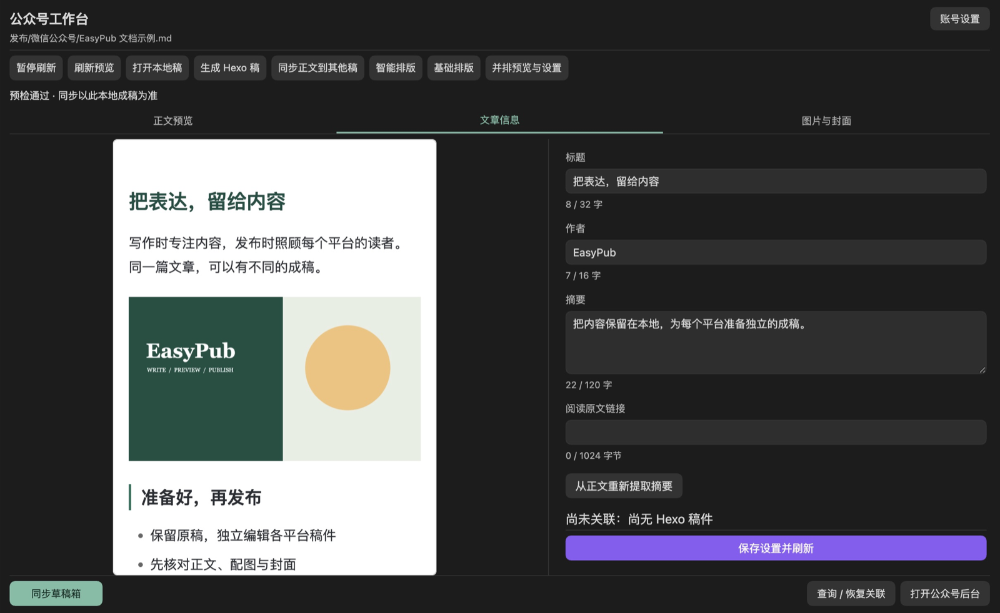

# 微信公众号工作台

[文档首页](README.md) · [快速开始](getting-started.md) · [主题与智能排版](wechat-layout.md) · [公众号与 Hexo 联动](wechat-association.md)

在 Obsidian 中完成公众号成稿、检查配图与封面，再同步到微信草稿箱。**本地成稿、微信草稿和正式发布是三个独立步骤。**

*工作台固定绑定一篇公众号本地稿。示例界面中的文章用于演示；最终显示仍需在微信后台和手机预览中确认。*

## 先完成一次本地成稿

1. 从源文章执行 `Publish to platform`，选择「微信公众号」，确认标题、作者、摘要和封面等属性。
2. 生成后，在公众号本地稿中继续修改正文。默认位置是 `发布/微信公众号/`。
3. 在工作台的「正文预览」检查内容；到「文章信息」核对文章属性，到「图片与封面」检查配图与裁剪。
4. 修改表单后点击「保存设置并刷新」。需要统一段落格式时使用「基础排版」；需要改变视觉风格时使用「智能排版」。
5. 准备同步时，连接账号并处理工作台显示的阻塞原因，再点击「同步草稿箱」。
6. 同步成功后打开公众号后台，检查桌面与手机效果，由你完成正式发布。

只生成本地稿、预览或使用本地主题时，无需配置公众号账号或 AI 服务。

### 三个页面分别做什么

| 页面 | 主要操作 |
| --- | --- |
| **正文预览** | 阅读当前稿件、刷新或暂停自动预览，检查排版效果 |
| **文章信息** | 编辑标题、作者、摘要、「阅读原文」，关联已发布的公众号文章 |
| **图片与封面** | 查看正文图片问题、选择封面、分别调整横版和方形裁剪 |

工作台默认在中央标签页打开。宽度达到 850px 时可点击「并排预览与设置」同时查看正文和设置；窄窗口使用上述页面切换。顶部显示绑定稿件路径，切换编辑器中的其他文章不会改变同步目标。

### 两种排版的区别

| 操作 | 保存的内容 | 是否改变 Markdown 正文 |
| --- | --- | --- |
| **基础排版** | 首行两个全角空格、段落间空行 | **会**，预览确认后整理当前稿件 |
| **智能排版** | 主题、强调色和区块组件方案 | **不会**，排版方案保存在文件头 |

两者都不会自动上传图片或写入微信。详见[基础排版规则](publishing-workbench.md#基础排版)和[主题与智能排版](wechat-layout.md)。

## 1. 本地稿与源文章

**已有公众号稿时，默认只打开，不重新导入源文章。**本地稿可以保留公众号专用修改；同步读取的是工作台当前绑定的本地稿，也不会把微信图片网址写回 Markdown 正文。

| 你想完成的事 | 使用哪个入口 |
| --- | --- |
| 继续编辑公众号成稿 | 工作台「打开本地稿」 |
| 用源文章重新替换公众号正文 | 从源文章执行「从源文章更新公众号本地稿（确认后替换正文）」并核对差异 |
| 只刷新标题、作者、摘要或封面 | 从源文章执行「从原稿刷新平台属性（选择字段）」 |
| 把本稿的部分正文改动带给其他稿件 | 工作台「同步正文到其他稿」并选择改动 |

替换正文会覆盖公众号稿中的独立文字修改；刷新属性则保留正文。两者都需要确认。更换封面会清除旧裁剪，请回工作台重新调整。

标题保存在顶层 `title`，其他公众号专用设置保存在 `wechat`。旧 `wechat.title` 会在确认保存时迁移，保留原展示标题。命令「预览并同步公众号草稿」作用于当前公众号本地稿，不能直接把源文章当作同步目标。

## 2. 账号配置

工作台右上角首次显示「连接公众号」，已有凭据时显示「账号设置」。也可从「设置 → EasyPub → 微信公众号 → 引导配置公众号」进入。

1. **准备账号**：确认素材与草稿接口权限，并在公众号后台配置当前网络的公网出口 IP 白名单。
2. **填写凭据**：输入 AppID、AppSecret 和可选默认作者，点击「保存并继续」。
3. **检查连接**：点击「运行只读检查」，分别查看令牌、素材读取和草稿读取结果。

「连接检查通过，可以返回编辑」表示只读检查通过；**图片上传和草稿写入仍要在首次同步时验证**。下方的“待实际同步验证”是范围说明，不是错误。

密钥保存、切换账号与代理说明

- 点击「保存并继续」之前关闭向导不会保存；保存后退出不会撤销已保存配置。
- 已有账号的密钥可留空保留。切换 AppID 必须提供对应的新密钥，会清除旧账号的已保存和会话密钥；素材缓存、草稿关联仍按账号隔离。
- AppSecret 优先使用系统加密保存；加密不可用时仅保留本次插件会话，重启或重载后需重新输入。迁移电脑也可能需要重输。
- 访问令牌仅缓存在内存。不要把 AppSecret 写进文章、截图或聊天。
- IP 白名单填写微信实际看到的公网出口；局域网地址不能代替公网出口。浏览器和 Obsidian 请求可能走不同代理路径。需要时展开向导中的「IP 白名单怎么填？使用代理怎么办？」。
- 检查连接只获取令牌并读取素材、草稿数量，不上传图片或创建草稿。部分项目失败时按失败原因处理后重新检查。

公众号账号配置与 Hexo、知乎、小红书和 PicGo 相互独立。

## 3. 预览与配图

### 编辑后怎样刷新

正文保存后约 500 毫秒自动刷新，尽量保持阅读位置；图片预留宽高比例，减少加载造成的跳动。点击「暂停刷新」后可以继续编辑，工作台会显示“预览待更新”；恢复刷新或手动点击「刷新预览」后才能同步。

文章信息或封面有未保存修改时，自动刷新会暂缓。若同时修改了正文，可先点击「刷新预览」读取最新正文并保留表单内容，再点击「保存设置并刷新」。首次同步也会保存尚未写入的默认设置。

已有摘要不会自动覆盖；需要重新生成时，点击「从正文重新提取摘要」，检查后保存。提取会跳过标题、代码、表格，优先使用普通正文段落。

### 配图出现问题时

支持 Vault 图片嵌入、Markdown 图片（含引用式）和 HTTP(S) 网络图片。图片按本地稿位置解析；「图片与封面」按正文引用顺序列出图片、转换结果或失败原因。

1. 展开失败项，核对图片路径与格式。
2. 点击「定位正文第 N 行」打开本地稿并修正引用；稿件已变化时先刷新再定位。
3. 返回工作台刷新，确认图片问题消失后再同步。

| 当前预检项目 | 要求与处理 |
| --- | --- |
| 正文图片 | 静态 JPG / PNG，处理后严格小于 1 MB |
| 封面 | 静态图片永久素材，处理后严格小于 10 MB |
| GIF、动态 WebP、APNG、AVIF 序列 | 先导出为静态图片，不自动丢弃动画帧 |
| SVG | 先导出为 PNG |
| 超大原图 | 超过 20 MB 或 8000 万像素时，先缩小再导入 |

静态图片会自动校正方向、缩放和压缩；透明图输出 PNG，其他图片输出 JPEG。正文图片宽度上限为 1280、高度上限为 8192，封面宽度上限为 2560。源附件保持不变；重复引用分别显示，处理和上传会复用结果。

> 预览可能读取网络图片；点击「同步草稿箱」后才向微信上传素材。公众号同步使用独立的微信上传流程，不调用 PicGo。

网络图片策略与下载限制

在「设置 → EasyPub → 公众号网络图片」选择「仅使用 Vault 附件」，可拒绝正文、封面及同步复核中的 HTTP(S) 图片。请先保存图片到 Vault 并修改引用；此模式也不将原始 HTML 交给宿主渲染。旧设置默认允许网络图片。

切换策略会清空旧预览、释放图片资源并禁用同步，请手动刷新。已经发出的下载或解码可能继续完成，但过期结果会被丢弃。此设置只约束 EasyPub 的图片读取，不是其他 Obsidian 渲染插件的网络沙箱。

下载使用 Electron 流式请求：实际接收上限 20 MB、总超时 15 秒、最多 5 次重定向，逐跳验证地址并拒绝 HTTPS 降级。宿主缺少流式接口时提示改用 Vault 附件，不退回无大小控制的下载。

带账号密码的 URL、localhost、`.local` 名称和明显的私网／特殊 IP 地址会被拒绝。普通 `2000::/3` IPv6 地址可用，但排除 IETF 协议分配 `2001::/23`、文档前缀 `2001:db8::/32`、`3fff::/20` 及 6to4 `2002::/16`。这是保守的 URL 检查，尚不覆盖域名解析到内网及 DNS 重绑定，不能作为完整 SSRF 防护。

实际代理行为仍需宿主验收。下载行为参考 [Electron ClientRequest](https://www.electronjs.org/docs/latest/api/client-request)，地址分类参考 [IANA IPv6 特殊用途地址表](https://www.iana.org/assignments/iana-ipv6-special-registry)。

Markdown 渲染支持范围

预览与提交共用规范化 HTML。未选择方案时使用默认模板；「智能排版」只应用受控视觉样式，不改正文。内部笔记链接显示为文本；不能可靠输出的笔记嵌入、公式、SVG、音视频等会提示修复。代码文本中的空格和缩进保留，微信最终显示仍需在后台检查。

暂停会取消排队中的刷新并丢弃进行中的旧渲染结果；暂停期间可手动刷新。图片处理中发起的手动刷新会排队执行。

## 4. 封面

默认预选正文第一张有效图片，也可在「图片与封面」中改选正文图片或点击「从附件选图」。选择封面不会插入或删除正文配图。

点击「调整封面裁剪」，分别设置两种构图：

| 比例 | 常见用途 | 插件的清晰度建议 |
| --- | --- | --- |
| **2.35:1** 横版 | 公众号横版封面 | 至少 900 × 383 |
| **1:1** 方形 | 方形展示位置 | 至少 383 × 383 |

拖动图片移动构图，使用滑条缩放，或聚焦裁剪框后按方向键微调。也可用居中、顶部居中、左上对齐、底部居中快捷定位。两组坐标分别保存，应用裁剪后仍需点击「保存设置并刷新」。

虚线是构图参考安全区，不会上传，也不保证微信所有展示位置均完整保留。低清晰度会提示，不强制拉伸；上表是清晰度建议，不是接口硬性门槛。

## 5. 同步与恢复

点击「同步草稿箱」后，插件先核对本地稿、附件、预览与账号，再上传正文图片和封面，最后创建或更新微信草稿。

| 工作台状态 | 建议操作 |
| --- | --- |
| 文章信息尚未保存 | 检查表单，点击「保存设置并刷新」 |
| 预览待更新 | 点击「刷新预览」或恢复自动刷新 |
| 图片、封面有问题 | 前往「图片与封面」处理提示 |
| 后台内容与上次同步不同 | 核对本地／远端差异，再决定覆盖或另建草稿 |
| 写入结果不确定 | 先在微信后台核对，再使用「查询 / 恢复关联」 |

首次同步创建单篇草稿，后续更新同一草稿。更新前及上传素材后都会检查后台内容；后台被手动修改时默认取消，不覆盖多图文合辑。远端草稿已删除或发布后，也需要你明确选择另建草稿。

如果出现超时、网络失败或写入后核对失败，微信可能已经保存成功。插件会保留“不确定”状态并阻止自动重试，避免重复创建。通过「查询 / 恢复关联」可从最近 20 个草稿中选择同一篇单篇草稿；下一次同步仍会核对差异。列表中找不到时先打开后台核验，确认没有待关联的新草稿后，才解除不确定状态。

同步成功后点击「打开公众号后台」，检查正文、两种封面和移动端效果，再手动发布。EasyPub 不群发、不定时发布，也不自动获取正式文章 URL。

素材复用、冲突对照与失败重试

同账号、同用途、处理后内容相同的素材复用缓存；正文图片与永久封面素材分别缓存。已删除的封面素材会重新上传。部分图片已上传但后续步骤失败时，保留成功缓存供重试，不自动删除远端素材。

冲突窗口并排显示标题、作者、摘要、原文链接和正文文本，并高亮差异。图片以文字标记，封面和裁剪单独列出；原始远端 HTML 可在「完整内容与说明」查看。文本一致不代表图片或排版完全一致。

## 6. 验证范围与官方接口

本地预览和自动测试不等于真实账号验收。接口权限与最终限制以微信实际返回为准；正式使用前，请在自己的账号检查首次创建、再次更新、配图和双比例封面。

EasyPub 当前按标题 32 字、作者 16 字、摘要 120 字，以及最终 HTML 2 万字符 / 1 MB 进行预检，不静默截断正文。

开发测试、历史验收与接口参考

自动测试使用模拟微信响应验证冲突、权限、缓存及不确定结果；浏览器测试使用 Obsidian API 替身验证真实视图组件。测试命令、浏览器环境和原生宿主检查见[测试指南](development/testing.md)，当前发布与验收范围见[版本状态](status.md)。本机有限制时，可按测试指南使用内置浏览器预览；完整浏览器套件在支持的 CI 环境运行。

2026-10-17 的 Obsidian 1.14.4 原生验收覆盖 Markdown、表格、嵌套列表、代码缩进、内部链接、EXIF 方向、长图、损坏图片与系统加密往返。临时测试插件不安装到磁盘、不修改笔记、不请求微信，不代表最低版本或真实账号已验收。详细记录见[公众号验收](wechat-acceptance.md)。

2026-10-22 已在 Sandbox 当时的代理环境验证公开 PNG 下载、大小超限及慢响应超时。`npm run test:wechat-download-native` 可复验；`EASYPUB_TEST_IMAGE_URL` 指定另一张公开 PNG，`EASYPUB_TEST_VAULT` 指定测试 Vault（默认 Sandbox）。测试网址仍须通过生产下载策略；历史结果不代表全部代理或历史宿主均已覆盖。

实现核对的微信文档（2026-10-16）：[新增草稿](https://developers.weixin.qq.com/doc/service/api/draftbox/draftmanage/api_draft_add)、[上传图文消息图片](https://developers.weixin.qq.com/doc/service/api/material/permanent/api_uploadimage)、[上传永久素材](https://developers.weixin.qq.com/doc/service/api/material/permanent/api_addmaterial)。封面使用永久素材，裁剪结构为 `cover_info.crop_percent_list`。

## 从公众号稿生成博客稿

工作台点击「生成 Hexo 稿」，可以创建博客草稿，或预览后更新同一篇博客正文。默认输出普通 Markdown，也可选择保留公众号排版的 HTML；两种方式都使用当前公众号本地稿，不自动部署。详见[两种输出方式](wechat-association.md#从公众号稿生成-hexo-稿)。

## 已发布文章与博客交流入口

正式发布后，可在「文章信息 → 公众号文章关联」中关联公开 URL，同步到同 `pub_id` 的 Hexo 稿。此功能独立于草稿箱同步，不修改「阅读原文」或微信远端内容。操作与恢复见[公众号与 Hexo 联动](wechat-association.md)。
